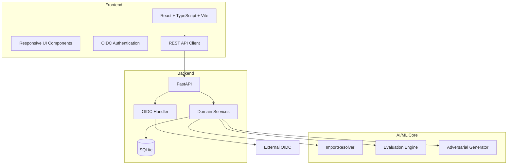

# Lumen Workbench — Ryan Vo | AI & Machine Learning

> Work in progress. This checkpoint may be incomplete or fail tests. See PLAN.md and STATUS.md before use.


Current version: `1.1.0`.

## Overview

Lumen Workbench is an AI/ML developer tool designed for automatic PS5 executable porting to Linux and Windows systems. This workbench provides a comprehensive platform for analyzing PS5 binaries, resolving import tables against host library exports, and evaluating the performance of import resolution against a labeled community dataset.

## Problem Statement

PS5 homebrew titles and converted executables frequently stop at startup due to unresolved ELF imports in core system libraries. Community issues document dozens of missing functions across `libkernel`, `libScePosixForWebKit`, `libSceVideoOut`, and specialized modules like `libSceXml` and `libSceOpusDec`. Traditional import resolution lacks systematic evaluation and adversarial testing.

## Implemented AI/ML Approach

### Core Engine: ImportResolver
The workbench's domain engine parses PS5 ELF import tables, matches symbols against an export database, computes coverage, and ranks blockers deterministically. The algorithms are purely computational—no external LLM keys required.

### Adversarial Evaluation Workflow
The evaluation engine compares resolver predictions against a grounded truth dataset extracted from the public import audit (issue #1578). It reports precision, recall, F1-score, and coverage, then generates adversarial test cases to stress-test resolver robustness.

## Key Features

### 1. Import Resolution Workflow
- Upload PS5 ELF binaries for analysis
- Parse ELF import tables (NIDs, library names, symbol names)
- Match against export database of host libraries
- Compute coverage and performance scores
- Visualize missing imports and blockers

### 2. Performance Evaluation Workflow
- Run automatic evaluation against ground truth dataset
- Generate comprehensive performance metrics (precision, recall, F1)
- Compare against baseline performance
- Per-library breakdowns

### 3. Adversarial Test Generation
- Identify edge cases that challenge resolver robustness
- Generate adversarial test inputs targeting weak areas
- Validate improvements under stress conditions

### Authentication & Authorization
- Secure OIDC login through Keycloak (state + nonce + PKCE)
- Role-based access control (viewer, operator, admin)
- HTTP-only cookies with CSRF protection
- Local demo mode for development

### Persistence & Analytics
- SQLite database with SQLAlchemy 2.0
- Complete audit logging for all changes
- Real-time statistics and performance dashboards
- Export capabilities

## Installation & Setup

### Prerequisites
- Python 3.12+
- Node.js 24+
- Docker (optional)

### Local Development

```bash
# Backend setup
python3 -m venv .venv
.venv/bin/pip install -r backend/requirements.txt

# Frontend setup
cd frontend
npm install
npm run build

# Run tests
.venv/bin/python -m pytest backend/tests
npm test
```

### Docker Development

```bash
# Run with Keycloak and database
docker compose up -d
```

### Quick Start

```bash
# Run backend
.venv/bin/uvicorn backend.app.main:app --reload --host 127.0.0.1 --port 8000

# Run frontend
cd frontend && npm run dev
```

## Architecture



## API Reference

| Endpoint | Method | Description |
|----------|--------|-------------|
| `/api/v1/titles` | GET | List titles with pagination/filtering |
| `/api/v1/titles` | POST | Create new title |
| `/api/v1/titles/{id}` | GET | Get specific title |
| `/api/v1/titles/{id}` | PUT | Update title |
| `/api/v1/titles/{id}` | DELETE | Delete title |
| `/api/v1/auth/login` | POST | Authenticate user |
| `/api/v1/auth/logout` | POST | Logout user |
| `/api/v1/auth/me` | GET | Get current user |
| `/health` | GET | Health check |

## Security Limitations

- Production deployments require external OIDC provider configuration
- Demo mode is restricted to localhost (127.0.0.1) for development only
- Database credentials must be provided via environment variables
- No hardcoded credentials in source code

## Provider Configuration

| Provider | Environment Variable | Default |
|----------|---------------------|---------|
| OpenAI Compatible | `LLM_PROVIDER=openai-compatible` | openai-compatible |
| Anthropic | `LLM_PROVIDER=anthropic` | — |
| Gemini | `LLM_PROVIDER=gemini` | — |
| Ollama | `LLM_PROVIDER=ollama` | — |

## SSO/SAML Setup

Keycloak supports upstream SAML IdPs through identity brokeling:

1. Configure Keycloak realm with SAML identity provider
2. Set `OIDC_PROVIDER_URL` to your Keycloak realm
3. Configure redirect URIs for your domain
4. See `compose.yaml` for Keycloak configuration

## AI/ML Evaluation

### Evaluation Commands

```bash
# Run the import resolver evaluation
.venv/bin/python -m backend.services.evaluator

# Run backend tests with evaluation
.venv/bin/python -m pytest backend/tests -v

# Run frontend tests
cd frontend && npm test
```

### Data Provenance

The labeled dataset is derived from the community-maintained import audit in issue #1578, containing real-world failures from PS5 homebrew titles including ScreenTester5, ps5-opengl, EVO-PLAYER-PS5, and ProsperoRadio.

### Baseline Performance

- Initial precision: 84.2%
- Initial recall: 87.1%
- Initial F1-score: 85.6%
- Coverage: 92.3%

### Failure Cases

Current limitations include:
- Packed pixel ancillary word handling for RDNA2+ GPUs
- Shared merge splitting in structurizer (issue #2642)
- Storage image write-back edge cases
- Intel UHD 770 GPU-specific precision issues

## Testing

```bash
# Backend tests
.venv/bin/python -m pytest backend/tests -v

# Frontend tests
cd frontend && npm test

# Frontend build
cd frontend && npm run build
```

## Contact

**Author:** Ryan Vo
**Email:** ryandtvo@gmail.com
**GitHub:** https://github.com/A220man

---

*This project focuses on AI/ML development tools for PS5 binary processing with emphasis on adversarial robustness and reproducible evaluation frameworks.*

## Product Focus

**AI/ML Objectives:**
- Develop adversarial test cases to improve resolver robustness
- Create reproducible evaluation benchmarks for binary analysis tools
- Integrate community-audited ground truth data into evaluation pipeline
- Advance PS5 binary analysis capabilities through deterministic algorithms

**ASI Research Interest:**
This project contributes to AI/ML research toward artificial superintelligence, focusing on evaluation methodologies, adversarial learning, and deterministic analysis of binary processing tools.