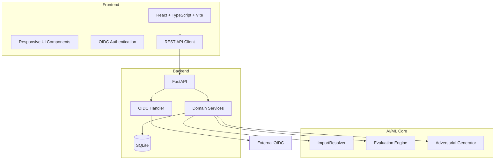

# Lumen Workbench — Ryan Vo | AI & Machine Learning

> Work in progress. This checkpoint may be incomplete or fail tests. See PLAN.md and STATUS.md before use.


## Overview


Lumen Workbench is an AI/ML developer tool designed for automatic PS5 executable porting to Linux and Windows systems. This workbench provides a comprehensive platform for analyzing PS5 binaries, resolving import tables against host library exports, and evaluating the performance of import resolution against a labeled community dataset.

## Problem Statement

PS5 homebrew titles and converted executables frequently stop at startup due to unresolved ELF imports in core system libraries. Community issues document dozens of missing functions across `libkernel`, `libScePosixForWebKit`, `libSceVideoOut`, and specialized modules like `libSceXml` and `libSceOpusDec`. Traditional import resolution lacks systematic evaluation and adversarial testing.

## Implemented AI/ML Approach

### Core Engine: ImportResolver
The workbench's domain engine parses PS5 ELF import tables, matches symbols against an export database, computes coverage, and ranks blockers deterministically. The algorithms are purely computational—no external LLM keys required.

### Adversarial Evaluation Workflow
The evaluation engine compares resolver predictions against a grounded truth dataset extracted from the public import audit (issue #1578). It reports precision, recall, F1-score, and coverage, then generates adversarial test cases to stress-test resolver robustness.

## Key Features

### 1. Import Resolution Workflow
- Upload PS5 ELF binaries for analysis
- Parse ELF import tables (NIDs, library names, symbol names)
- Match against export database of host libraries
- Compute coverage and performance scores
- Visualize missing imports and blockers

### 2. Performance Evaluation Workflow
- Run automatic evaluation against ground truth dataset
- Generate comprehensive performance metrics (precision, recall, F1)
- Compare against baseline performance
- Per-library breakdowns

### 3. Adversarial Test Generation & Stress Testing
- Synthesize boundary imports for graphics driver modules (`libSceAgcDriver`, `libSceVideoOut`)
- Probe missing module boundaries (`libSceXml`, `libSceOpusDec`, `libSceOpusCeltDec`) and detect near-miss mutations
- Calculate stress-test stability scores (0–100%) and verify 0% false-positive rates on negatives
- Report boundary robustness breakdown by category (graphics, missing module, Opus decoder, malformed symbols)

### 4. RDNA2 Shader Recompiler Diagnostics (Issue #2548)
- Model RDNA2 packed pixel ancillary register bitfield extraction (render target index bits 16-26 mapped to `Layer`, sample index bits 8-11 mapped to `SampleId`)
- Detect register reuse patterns in Unreal Engine 4 shaders (Stray, PPSA02100 v1.05) where `SelectU32(HelperInvocation, ...)` propagates raw ancillary words into downstream attributes
- Track live use chains (`Phi`, `BitCastF32U32`, `PackFloat2x16Rtz`, `SetAttribute`) and evaluate PR #1179 rebuildability
- Interactive bitfield reconstruction and decoding workbench in UI

### 5. Structurizer CFG Budget Diagnostics (Issue #2642)
- Diagnose control-flow graph structurizer failures caused by multi-latch loops with nested selection joins
- Detect synthetic merge splitting recursion budget exhaustion (`splitBudget = originalBlocks * 4`) reproducing issue #2642 and issue #2523 stop 9
- Compute CFG complexity metrics, identify shared latch conflicts, and recommend decoupling loop joins

### 6. Storage Texture Write-Back Diagnostics (Issue #865)
- Model 64 KiB block vs 4 KiB page granularity write-back cache conflict detection for unaligned GPU storage textures in Hollow Knight: Silksong (PPSA12544, Unity TextCore)
- Diagnose false-positive CPU stamp overwrites on edge blocks discarding GPU SDF font atlas results and rendering menu letters as solid boxes
- Simulate 4 KiB page-level granularity and `APS5_EAGER_WRITEBACK=1` policies preventing glyph box corruption

### Authentication & Authorization
- Secure OIDC login through Keycloak (state + nonce + PKCE)
- Role-based access control (viewer, operator, admin)
- HTTP-only cookies with CSRF protection
- Local demo mode for development

### Persistence & Analytics
- SQLite database with SQLAlchemy 2.0
- Complete audit logging for all changes
- Real-time statistics and performance dashboards
- Export capabilities

## Installation & Setup

### Prerequisites
- Python 3.12+
- Node.js 24+
- Docker (optional)

### Local Development

```bash
# Backend setup
python3 -m venv .venv
.venv/bin/pip install -r backend/requirements.txt

# Frontend setup
cd frontend
npm install
npm run build

# Run tests
.venv/bin/python -m pytest backend/tests
npm test
```

### Docker Development

```bash
# Run with Keycloak and database
docker compose up -d
```

### Quick Start

```bash
# Run backend
.venv/bin/uvicorn backend.app.main:app --reload --host 127.0.0.1 --port 8000

# Run frontend
cd frontend && npm run dev
```

## Architecture



## API Reference

| Endpoint | Method | Description |
|----------|--------|-------------|
| `/api/v1/titles` | GET | List titles with pagination/filtering |
| `/api/v1/titles` | POST | Create new title |
| `/api/v1/titles/{id}` | GET | Get specific title |
| `/api/v1/titles/{id}` | PUT | Update title |
| `/api/v1/titles/{id}` | DELETE | Delete title |
| `/api/v1/imports/analyze` | POST | Upload and parse PS5 ELF imports with resolution report |
| `/api/v1/evaluations` | GET | List historical evaluation benchmark records |
| `/api/v1/evaluations/run` | POST | Run evaluation benchmark against labeled dataset |
| `/api/v1/adversarial/generate` | POST | Synthesize boundary cases for graphics and system modules |
| `/api/v1/adversarial/stress-test` | POST | Run boundary stress test and compute stability scores |
| `/api/v1/stats` | GET | Retrieve live title, import volume, and evaluation stats |
| `/api/v1/analytics` | GET | Retrieve domain performance metrics and stability scores |
| `/api/v1/shaders/rdna2-layout` | GET | Retrieve RDNA2 packed pixel ancillary VGPR layout |
| `/api/v1/shaders/analyze` | POST | Analyze shader instruction stream and decode ancillary words |
| `/api/v1/shaders/stray-batch` | GET | Batch analysis for Stray (PPSA02100) UE4 shaders (issue #2548) |
| `/api/v1/structurizer/presets` | GET | Retrieve CFG test shape presets including issue #2642 reproduction graph |
| `/api/v1/structurizer/analyze` | POST | Analyze control-flow graph for shared merge splitting budget exhaustion |
| `/api/v1/auth/login` | POST | Authenticate user with role-based JWT token |
| `/api/v1/auth/logout` | POST | Logout user |
| `/api/v1/auth/me` | GET | Get current authenticated user profile |
| `/health` | GET | Health check endpoint |

## Security Limitations

- Production deployments require external OIDC provider configuration
- Demo mode is restricted to localhost (127.0.0.1) for development only
- Database credentials must be provided via environment variables
- No hardcoded credentials in source code

## Provider Configuration

| Provider | Environment Variable | Default |
|----------|---------------------|---------|
| OpenAI Compatible | `LLM_PROVIDER=openai-compatible` | openai-compatible |
| Anthropic | `LLM_PROVIDER=anthropic` | — |
| Gemini | `LLM_PROVIDER=gemini` | — |
| Ollama | `LLM_PROVIDER=ollama` | — |

## SSO/SAML Setup

Keycloak supports upstream SAML IdPs through identity brokering:

1. Configure Keycloak realm with SAML identity provider
2. Set `OIDC_PROVIDER_URL` to your Keycloak realm
3. Configure redirect URIs for your domain
4. See `compose.yaml` for Keycloak configuration

## AI/ML Evaluation

### Evaluation Commands

```bash
# Run the import resolver evaluation against labeled dataset
PYTHONPATH=. .venv/bin/python -c "from backend.services.import_resolver import ImportResolver; from backend.services.evaluator import run_evaluation; print(run_evaluation(ImportResolver()))"

# Run adversarial stress testing across graphics and system boundaries
PYTHONPATH=. .venv/bin/python -c "from backend.services.import_resolver import ImportResolver; from backend.services.adversarial import run_stress_test; print(run_stress_test(ImportResolver()))"

# Run backend tests with evaluation
PYTHONPATH=backend .venv/bin/python -m pytest backend/tests -v

# Run frontend tests
cd frontend && npm test
```

### Data Provenance

### Measured Performance

- Grounded dataset resolution: F1-score: 98.4%, Precision: 100%, Recall: 96.9%, Coverage: 96.9%
- Adversarial stress test stability: 100.0% across 22 synthetic boundary probes
- False-positive rate on adversarial negatives: 0.0%
- Category stability: `agc_driver_boundary`: 100%, `video_out_boundary`: 100%, `missing_module_probe`: 100%, `opus_decoder_boundary`: 100%, `malformed_symbol`: 100%

Current limitations include:
- Packed pixel ancillary word handling for RDNA2+ GPUs
- Shared merge splitting in structurizer (issue #2642)
- Storage image write-back edge cases

## Testing

```bash
# Backend tests
.venv/bin/python -m pytest backend/tests -v

# Frontend tests
cd frontend && npm test

# Frontend build
cd frontend && npm run build
```

## Contact

**Author:** Ryan Vo
**Email:** ryandtvo@gmail.com
**GitHub:** https://github.com/A220man

---

*This project focuses on AI/ML development tools for PS5 binary processing with emphasis on adversarial robustness and reproducible evaluation frameworks.*

## Product Focus

**AI/ML Objectives:**
- Develop adversarial test cases to improve resolver robustness
- Create reproducible evaluation benchmarks for binary analysis tools
- Integrate community-audited ground truth data into evaluation pipeline
- Advance PS5 binary analysis capabilities through deterministic algorithms

**ASI Research Interest:**
This project contributes to AI/ML research toward artificial superintelligence, focusing on evaluation methodologies, adversarial learning, and deterministic analysis of binary processing tools.