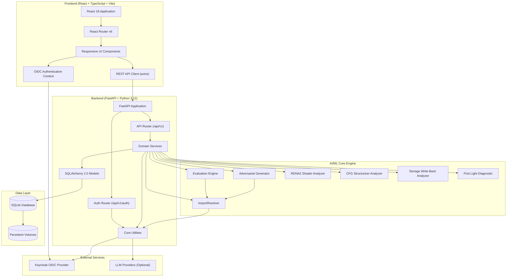

# Lumen Workbench Architecture

## Overview

Lumen Workbench is an AI/ML developer tool for PS5 executable porting analysis. It provides a full-stack web application with a React/TypeScript frontend and a FastAPI/Python backend, using SQLite for persistence and Keycloak for OIDC authentication.

## System Architecture



## Component Details

### Frontend (`frontend/`)

**Technology Stack:**
- React 18 with TypeScript
- Vite for build tooling
- React Router v6 for SPA routing
- Axios for HTTP client
- Vitest + React Testing Library for tests
- Tailwind CSS for styling (via CDN in index.html)

**Key Components:**
- `App.tsx` - Root component with routing and auth provider
- `layout.tsx` - Main layout with navigation and auth state
- `context.tsx` - React context for auth state and API client
- `hooks.ts` - Custom hooks (`useAuth`, `useApiClient`)
- `api.ts` - Typed API client with all endpoint methods

**Pages/Components:**
- `dashboard.tsx` - Title list with CRUD operations
- `import-analysis.tsx` - ELF upload, analysis, export (JSON/CSV)
- `shader-analyzer.tsx` - RDNA2 ancillary VGPR analysis
- `structurizer-panel.tsx` - CFG structurizer diagnostics
- `storage-writeback.tsx` - Storage texture write-back simulation
- `first-light-diagnostic.tsx` - 007 First Light startup stops
- `analytics.tsx` - Performance metrics and stability scores
- `evaluation-table.tsx` - Historical evaluation records
- `profile.tsx` - User profile and role display
- `status.tsx` - System status and health

**State Management:**
- React Context for authentication state
- Local component state for forms and UI interactions
- No global state library (Redux/Zustand) - kept simple

### Backend (`backend/`)

**Technology Stack:**
- FastAPI 0.115 with Python 3.12
- SQLAlchemy 2.0 (sync) with SQLite
- PyJWT for token handling
- httpx for async HTTP clients
- Pydantic v2 for validation
- pytest + pytest-asyncio for tests

**Module Structure:**
```
backend/
├── app/
│   ├── main.py           # FastAPI app factory, lifespan, health
│   └── api/
│       ├── router.py     # Main API endpoints
│       └── auth.py       # OIDC/PKCE auth endpoints
├── core/
│   ├── config.py         # Settings from environment
│   ├── db.py             # SQLAlchemy engine/session
│   ├── security.py       # PKCE/OIDC protocol helpers
│   ├── redaction.py      # Credential redaction for logs
│   ├── nid.py            # NID hashing utilities
│   ├── elf_parser.py     # ELF import table parsing
│   └── config.py         # Settings
├── models/
│   ├── title.py          # Title ORM model
│   ├── user.py           # User ORM model
│   ├── import_record.py  # Import analysis records
│   ├── evaluation.py     # Evaluation benchmark records
│   ├── audit.py          # Audit log entries
│   ├── pending_auth.py   # PKCE state storage
│   └── title_status_history.py
├── schemas/              # Pydantic request/response models
├── services/
│   ├── import_resolver.py   # Core domain: ELF import resolution
│   ├── export_db.py         # Export database of host libraries
│   ├── evaluator.py         # Benchmark evaluation engine
│   ├── adversarial.py       # Adversarial test generation
│   ├── shader_analyzer.py   # RDNA2 shader diagnostics
│   ├── structurizer.py      # CFG structurizer analysis
│   ├── storage_writeback.py # Storage texture diagnostics
│   ├── first_light_diagnostic.py
│   ├── title_registry.py    # Title CRUD service
│   ├── provider.py          # LLM provider adapters
│   └── advisory.py          # LLM advisory explanations
└── tests/
```

### Domain Engine (`backend/services/`)

The domain engine implements **deterministic algorithms** - no external LLM keys required for core functionality.

#### ImportResolver (`import_resolver.py`)
- Parses PS5 ELF import tables (NIDs, library names, symbol names)
- Matches against export database (`export_db.py`) of host library exports
- Computes coverage, scores, and ranks blockers
- Purely computational, no network calls

#### Evaluation Engine (`evaluator.py`)
- Compares resolver predictions against grounded truth dataset
- Grounded truth extracted from AnyPS5 issue #1578 import audit
- Reports precision, recall, F1-score, coverage
- Per-library breakdowns

#### Adversarial Generator (`adversarial.py`)
- Synthesizes boundary test cases across categories:
  - Graphics driver modules (`libSceAgcDriver`, `libSceVideoOut`)
  - Missing module boundaries (`libSceXml`, `libSceOpusDec`, `libSceOpusCeltDec`)
  - Opus decoder boundaries
  - Malformed symbol mutations
- Stress-tests resolver robustness
- Calculates stability scores (0-100%) and verifies 0% false-positive rates

#### RDNA2 Shader Analyzer (`shader_analyzer.py`)
- Models packed pixel ancillary VGPR bitfield extraction
- Render target index (bits 16-26) → `Layer` builtin
- Sample index (bits 8-11) → `SampleId` builtin
- Detects UE4 register reuse patterns (issue #2548)
- Tracks live use chains: `Phi` → `BitCastF32U32` → `PackFloat2x16Rtz` → `SetAttribute`
- Evaluates PR #1179 rebuildability

#### Structurizer Analyzer (`structurizer.py`)
- Diagnoses CFG structurizer failures (issue #2642)
- Multi-latch loops with nested selection joins
- Detects shared merge splitting recursion budget exhaustion
- Computes CFG complexity metrics
- Recommends decoupling loop joins

#### Storage Write-Back Analyzer (`storage_writeback.py`)
- Models 64 KiB block vs 4 KiB page granularity conflicts (issue #865)
- Diagnoses false-positive CPU stamp overwrites on edge blocks
- Simulates `APS5_EAGER_WRITEBACK=1` and page-level policies
- Prevents GPU SDF font atlas glyph corruption

#### First Light Diagnostic (`first_light_diagnostic.py`)
- Models 13-stop startup sequence for 007 First Light (issue #2523)
- Tracks PR references, shader-cache miss counts, verification status
- Regression detection for applied PR sets

### Authentication & Authorization

**Architecture: Backend-managed sessions with HttpOnly SameSite cookies and CSRF protection**

- OIDC Authorization Code Flow with PKCE (RFC 7636)
- State + nonce + code verifier generated server-side
- Provider discovery via `/.well-known/openid-configuration`
- JWKS fetched from issuer, RS256 signature validation
- Audience, issuer, nonce, expiration verified
- Roles: `viewer` (read-only), `operator` (read/write), `admin` (full)
- Demo mode for localhost development only (refused in production)

**Token Flow:**
1. Client calls `GET /auth/authorize` → receives authorization URL + state
2. User authenticates at Keycloak → redirected to `/auth/callback?code=...&state=...`
3. Backend exchanges code for tokens using PKCE verifier
4. Backend validates ID token (signature, issuer, audience, nonce)
5. Backend issues internal JWT (HS256) with roles
6. Client uses Bearer token for API requests

### LLM Advisory (Optional)

- Opt-in via `LLM_API_KEY` environment variable
- Supports: OpenAI-compatible, Anthropic, Gemini, Ollama
- Explanations clearly labeled `[ADVISORY]`
- Grounded in actual records (import reports, title history)
- Provider errors surfaced, never fabricated responses
- Bounded timeouts, redacted errors

### Data Persistence

- SQLite with SQLAlchemy 2.0
- Persistent volumes in Docker (`lumen-data`)
- Models: Title, User, ImportRecord, Evaluation, AuditLog, PendingAuth, TitleStatusHistory
- UTC timestamps, pagination, filtering, validation
- Audit logging for all mutations

## Data Flow Examples

### Import Analysis Workflow
```
User uploads ELF → Frontend POST /imports/analyze
                    ↓
Backend: ImportResolver.parse_elf() → extract imports
                    ↓
ImportResolver.resolve() → match against export_db
                    ↓
Generate ResolutionReport → store ImportRecord
                    ↓
Return report + optional LLM advisory
                    ↓
Frontend displays coverage, blockers, export buttons
```

### Adversarial Stress Test Workflow
```
User triggers stress test → POST /adversarial/stress-test
                              ↓
AdversarialGenerator.generate_cases() → synthetic symbols
                              ↓
ImportResolver.resolve() on each case
                              ↓
Compute stability scores per category
                              ↓
Return report → Frontend displays breakdown
```

## Security Boundaries

- All API endpoints require valid JWT (except `/health`, `/auth/config`, `/auth/authorize`)
- Role-based access control on all data endpoints
- OIDC tokens validated via JWKS (RS256)
- Internal JWTs signed with HS256 (`LUMEN_SECRET_KEY`)
- Demo mode refused when `HOST` not in `127.0.0.1/localhost`
- No credentials in source code or images
- Credential redaction in logs
- CSRF protection on cookie-authenticated writes (when enabled)

## Deployment Topology

```
┌─────────────────────────────────────────────────────────┐
│                     Reverse Proxy (TLS)                 │
│  nginx/Traefik/Caddy → terminates TLS, routes by host  │
└─────────────────────────────────────────────────────────┘
                            │
        ┌───────────────────┼───────────────────┐
        ▼                   ▼                   ▼
┌───────────────┐   ┌───────────────┐   ┌───────────────┐
│   Frontend    │   │    Backend    │   │   Keycloak    │
│  (nginx:80)   │   │ (uvicorn:8000)│   │  (keycloak:8080)│
└───────────────┘   └───────────────┘   └───────────────┘
                            │                   │
                            ▼                   ▼
                     ┌───────────────┐   ┌───────────────┐
                     │   SQLite DB   │   │  Keycloak DB  │
                     │  (volume)     │   │  (volume)     │
                     └───────────────┘   └───────────────┘
```

## Scaling Considerations

- SQLite suitable for single-instance deployments
- For multi-instance: migrate to PostgreSQL (configured via `DATABASE_URL`)
- Keycloak can be externalized to managed service
- Frontend static assets can be served via CDN
- LLM advisory calls are async with timeouts; can be rate-limited

## Extension Points

- New diagnostic services: add to `services/`, register in `router.py`
- New LLM providers: implement in `provider.py`
- New export formats: extend `import-analysis.tsx` export function
- New adversarial categories: extend `adversarial.py` generator